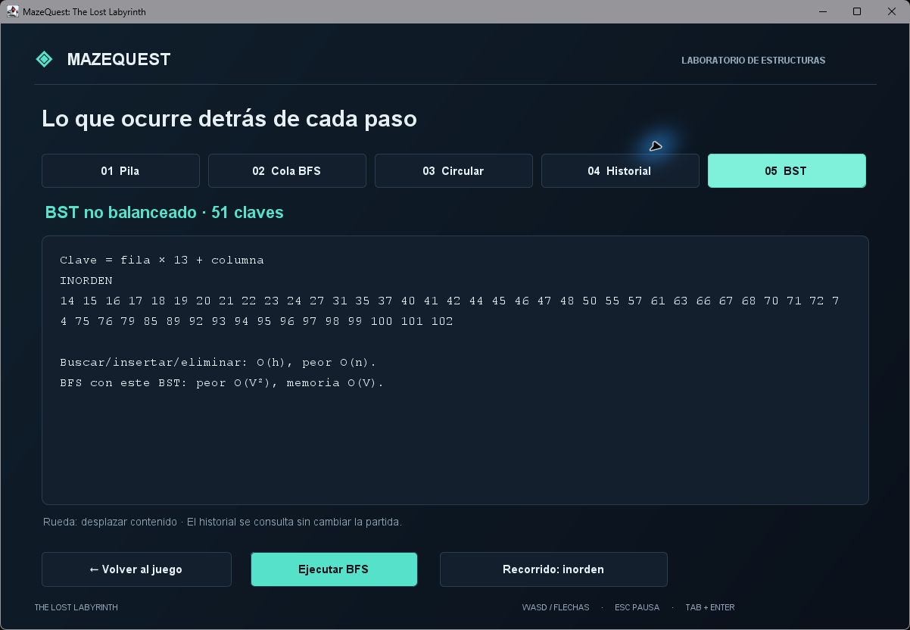

# Manual técnico
MazeQuest · Estructuras de Datos

Versión 1.0.0 · 15 de noviembre de 2026

## 1. Construcción y arquitectura
Java 21, Maven, JUnit 5, Swing y Java2D. Entrada: mazequest.Main. Motor, modelos, estructuras y BFS funcionan sin ventanas. Swing queda en la entrada, el controlador y la vista.

```text
mvn -B -ntp clean verify javadoc:javadoc
java -jar target/mazequest.jar
```

El POM fija release 21 y un JAR con Main-Class. Surefire ejecuta JUnit con java.awt.headless=true. Javadoc activa doclint y failOnWarnings. target es generado y no se versiona.

| Paquete | Responsabilidad |
|---|---|
| structures | CustomStack, CustomQueue, CircularLinkedList, DoublyLinkedList y BinarySearchTree; nodos propios. |
| model | Position, Maze, Enemy y Levels; mapas, validación y patrullas. |
| algorithms | BreadthFirstSearch y SearchResult; búsqueda e inspección del resultado. |
| engine | GameEngine, GameSnapshot, MoveRecord y GameStatus; reglas y reversibilidad. |
| controller | GameController; acciones y búsqueda asíncrona. |
| view | GamePanel y Palette; Java2D, eventos, diálogos y laboratorio. |

view usa controller y modelos de consulta; controller usa engine y algorithms; engine usa model y structures; algorithms usa model y structures. Las capas inferiores no importan Swing.

VS Code usa configuraciones portables en .vscode: extensiones Java/Maven, tareas y lanzamiento de mazequest.Main. Configurar JDK 21 localmente, sin rutas personales compartidas. Los scripts también pueden usar Java/Maven instalados en el sistema.

<!-- pagebreak -->
## 2. Estructuras e invariantes
Las cinco estructuras usan nodos y referencias propios. No las sustituyen colecciones de java.util. Los arreglos de mapas, instantáneas y resultados son almacenamiento auxiliar.

| Estructura | Invariante y uso | Costos |
|---|---|---|
| Pila | top apunta al último estado; next al anterior. LIFO para deshacer. | push, pop, peek O(1); recorrido O(n). |
| Cola | first y last se vacían juntos; last.next es null. Frontera FIFO. | enqueue, dequeue, peek O(1). |
| Circular | tail.next es el primero; singleton se apunta a sí mismo. Patrullas. | Inserción extremos y avance O(1); índice y seek O(n). |
| Doble | Extremos externos nulos y enlaces vecinos recíprocos. Historial. | Extremos O(1); índice/búsqueda O(n); recorrido O(n). |
| BST | Izquierda menor, derecha mayor; sin duplicados. Visitados BFS. | Operaciones O(h), peor O(n); recorridos O(n). |

Al insertar entre nodos se conserva primero el enlace al resto. Al eliminar se reparan enlaces vecinos y extremos. Las pruebas cubren vacío, singleton, índices, extremos y retirada del último elemento. El cursor circular comprueba una versión: editar la lista invalida cursores previos.

En el BST, quitar una hoja libera el enlace; con un hijo se promueve ese hijo; con dos, se usa el sucesor inorden. No hay balanceo. Sus recorridos usan pila propia y no dependen de recursión profunda.

Cada estructura ocupa O(n). Una instantánea contiene un índice por enemigo: T turnos con G guardianes ocupan O(T·(G+1)), además de mapa y rutas. pop es O(1), pero restaurar el turno recoloca cada cursor con seek y no es necesariamente O(1).

<!-- pagebreak -->
## 3. BFS y costo real
BreadthFirstSearch.find recibe un Maze y posiciones transitables. Rechaza mapa nulo o extremos inválidos; no consulta Swing ni modifica la partida.

1. Crea cola y BST propios; encola y marca el origen.
2. Desencola una celda; si es el objetivo, termina.
3. Revisa cuatro vecinos ortogonales y descarta muros o visitados.
4. Al descubrir una celda, registra predecesor, marca y encola una sola vez.
5. Reconstruye desde el destino mediante la matriz de predecesores.

La clave fila × columnas + columna identifica cada celda. Marcar al encolar impide duplicados en la frontera. FIFO expande distancias por capas; con aristas de igual costo obtiene una ruta mínima estática. No garantiza seguridad frente a patrullas.

El costo documentado en código es O(A + (V+E)h + F²): A es el área del tablero; V, celdas descubiertas; E, conexiones inspeccionadas; h, altura del BST; F, máxima frontera. El término F² cubre las copias diagnósticas cada vez que crece el máximo de cola. En cuadrícula, el peor tiempo es O(A²) y el espacio O(A), incluida la matriz de predecesores. No se promete O(V+E).

SearchResult conserva ruta, descubrimiento, recorridos del BST y una copia histórica de la máxima cola. Sus arreglos se devuelven mediante copias defensivas. La búsqueda de posición y fase enemiga solo existe en PlayableLevelsTest, no en la ayuda del juego.

## 4. Concurrencia
Main crea la ventana en el EDT. Los eventos y el Swing Timer se ejecutan allí. Timer solicita repintados, no consume turnos. GamePanel interpola los pasos sin dormir el hilo ni alterar el resultado lógico.

GameController calcula BFS en SwingWorker.doInBackground; done publica en el EDT. Cambiar el mundo aumenta revision, elimina la pista y cancela el worker previo. Una respuesta de otra revisión se descarta. Cancelar no implica que BFS compruebe interrupciones durante cada expansión; la revisión evita publicar datos obsoletos.

<!-- pagebreak -->
## 5. Motor e historial
move acepta delta ortogonal unitario, destino transitable y estado PLAYING. Otras entradas devuelven false sin cambiar turno, vidas, enemigos, pila o historial.

Antes de mutar se guarda GameSnapshot. Se compara el destino del jugador con la posición anterior de cada enemigo, se avanza el enemigo y se compara otra vez. El booleano hit acumula colisiones y limita el daño a una vida. La comprobación previa también detecta intercambios.

Con daño, jugador y patrullas vuelven al inicio; cero vidas fija LOST. Sin daño, alcanzar la salida fija WON. Maze impide patrullas sobre entrada o salida. MoveRecord conserva origen, destino intentado, posición final y daño.

undo restaura jugador, vidas, contador, estado y cursores, y retira el último registro. Puede revertir WON y LOST. GameSnapshot copia el arreglo de índices al construir y consultar. Consultar el historial no cambia la partida. restart vacía pila e historial y restaura tres vidas; vista y controlador reinician reloj y pistas. Estos dos datos de sesión no son reversibles.

## 6. Laboratorio real


Esta captura archivada precede al arreglo que evita dividir una clave entre líneas. No se retocó para simular otra ejecución. Pila, circular e historial muestran el motor; cola y BST proceden del último SearchResult vigente.

<!-- pagebreak -->
## 7. Validación y mantenimiento
Compilación limpia local del 15 de noviembre de 2026 con Java 21.0.13: 21 pruebas, cero fallos, errores y omisiones; Javadoc correcto. Evidencia en docs/validacion.md e informes actuales en target/surefire-reports.

| Clase | Pruebas | Evidencia principal |
|---|---|---|
| StructuresTest | 8 | LIFO, FIFO, enlaces, cursores, índices, duplicados y eliminaciones. |
| BreadthFirstSearchTest | 4 | Ruta mínima, inalcanzable, misma celda, extremos y copias. |
| GameEngineTest | 7 | Colisiones, vidas, historial, reinicio, reversión y mapas. |
| PlayableLevelsTest | 2 | Intercambio real y victoria con enemigos en los tres niveles. |

El verificador explora celda y fase, reconstruye secuencias y las reproduce en GameEngine: El umbral gana en 16 turnos, Las galerías en 26 y El santuario en 32, todos con tres vidas. Son resultados automatizados, no partidas humanas ni mediciones de velocidad.

CI del commit 2f9d04b, ejecución 43664777093: cuatro trabajos exitosos en ubuntu-latest/windows-latest con Java 21/25. Incluye compilación, pruebas y Javadoc, sin ventanas. No verifica la GUI de Linux. El JAR local se compila con release 21.

Para agregar mapas, respetar rectangularidad, símbolos, entrada/salida únicas y patrullas transitables, adyacentes y cerradas. Ampliar pruebas con enemigos: la resolubilidad estática no basta. Para cambiar reglas, actualizar motor, pruebas, arquitectura y trazabilidad. Conservar Javadoc en español y comentarios de invariantes y enlaces.

Los informes reales de OpenCode se conservan en docs/reviews. Los manuales se generan desde Markdown mediante scripts/build_manuals.py y usan capturas de docs/screenshots.

Pendientes externos: PDF académico original, datos de autoría, GUI en Linux y detención efectiva en breakpoint. No se afirma cobertura porcentual ni revisión manual completa de todas las pantallas.
