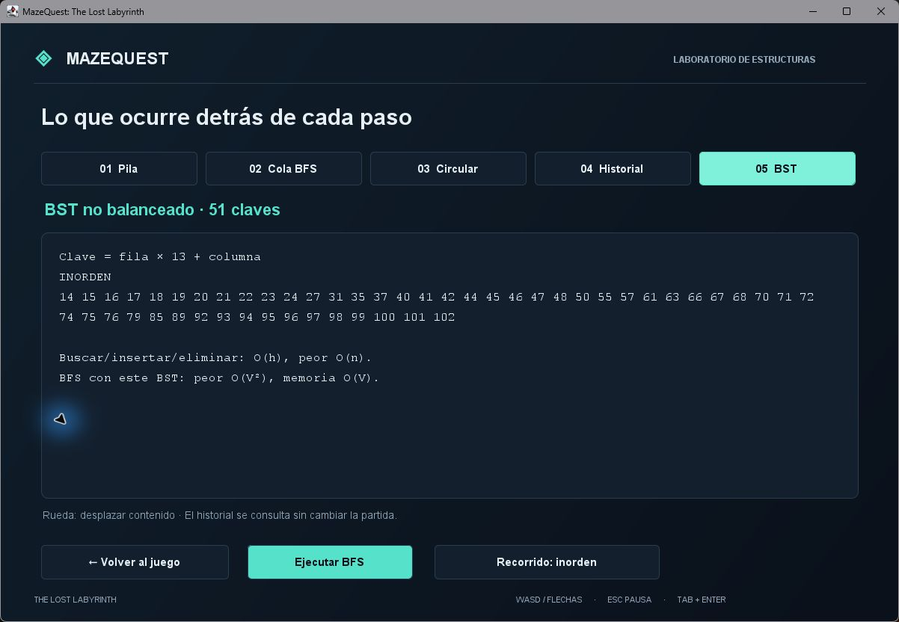

# Manual técnico
MazeQuest · Estructuras de Datos

Versión 1.0.0 · 16 de noviembre de 2026

Equipo: Juan David Paz Rodriguez y Andrea Fernanda Sapuyez.

## 1. Construcción y arquitectura
Java 21 (validado con 21.0.13), Maven 3.9.11, JUnit Jupiter 5.11.4, Swing y Java2D del JDK. Entrada: mazequest.Main. Motor, modelos, estructuras y BFS funcionan sin ventanas. Swing queda en la entrada, el controlador y la vista.

```text
mvn -B -ntp clean verify javadoc:javadoc
java -jar target/mazequest.jar
```

El POM fija release 21 y un JAR con Main-Class. Surefire ejecuta JUnit con java.awt.headless=true. Javadoc activa doclint y failOnWarnings. target es generado y no se versiona.

| Paquete | Responsabilidad |
|---|---|
| structures | CustomStack, CustomQueue, CircularLinkedList, DoublyLinkedList y BinarySearchTree; nodos propios. |
| model | Position, Maze, Enemy y Levels; mapas, validación y patrullas. |
| algorithms | BreadthFirstSearch y SearchResult; búsqueda e inspección del resultado. |
| engine | GameEngine, GameSnapshot, MoveRecord y GameStatus; reglas y reversibilidad. |
| controller | GameController; acciones y búsqueda asíncrona. |
| view | GamePanel y Palette; Java2D, eventos, diálogos y laboratorio. |

view usa controller y modelos de consulta; controller usa engine y algorithms; engine usa model y structures; algorithms usa model y structures. Las capas inferiores no importan Swing.

VS Code usa configuraciones portables en .vscode: extensiones Java/Maven, tareas y lanzamiento de mazequest.Main. Configurar JDK 21 localmente, sin rutas personales compartidas. Los scripts también pueden usar Java/Maven instalados en el sistema.

Los scripts de Windows respetan JAVA_HOME explícito y validan java/javac. Si no está definido, buscan JDK 21 local y después usan PATH. No sustituyen una selección explícita por otro JDK instalado.

<!-- pagebreak -->
## 1.1. Diagrama de clases: aplicación
Vista simplificada con atributos y operaciones seleccionados. Flecha continua: referencia; discontinua: dependencia o creación; rombo negro: objeto creado y gestionado por su propietario. Se omiten accesores y dependencias auxiliares para conservar legibilidad.

<!-- diagram: core -->

Main crea GamePanel en el EDT. Levels construye Maze; Position es un registro de fila y columna. GameStatus enumera PLAYING, WON y LOST. Palette aporta colores a la vista. GameController conserva el SearchResult publicado; BFS también recibe Maze y Position, sin depender de la interfaz.

<!-- pagebreak -->
## 1.2. Diagrama de clases: nodos
Cada Nodo pertenece a su propia clase contenedora: son cinco implementaciones privadas distintas. El rombo indica propiedad de cero o más nodos; sus campos muestran los enlaces. Los nombres de operaciones se abrevian omitiendo parámetros. El cursor circular conserva una referencia auxiliar persistente para la patrulla.

<!-- diagram: structures -->

<!-- pagebreak -->
## 2. Estructuras e invariantes
Las cinco estructuras usan nodos y referencias propios. No las sustituyen colecciones de java.util. Los arreglos de mapas, instantáneas y resultados son almacenamiento auxiliar.

| Estructura | Invariante y uso | Costos |
|---|---|---|
| Pila | tope apunta al último estado; sig al anterior. LIFO para deshacer. | apilar, desapilar, verTope O(1); recorrido O(n). |
| Cola | inicio y fin se vacían juntos; fin.sig es null. Frontera FIFO. | encolar, desencolar, verFrente O(1). |
| Circular | ultimo.sig es cabecera; singleton se apunta a sí mismo. Patrullas. | Inserción extremos y avance O(1); índice y seek O(n). |
| Doble | Extremos externos nulos y enlaces vecinos recíprocos. Historial. | Extremos O(1); índice/búsqueda O(n); recorrido O(n). |
| BST | Izquierda menor, derecha mayor; sin duplicados. Visitados BFS. | Operaciones O(h), peor O(n); recorridos O(n). |

Ubicación: src/main/java/mazequest/structures/. La pila corresponde a CustomStack.java; cola, CustomQueue.java; circular, CircularLinkedList.java; doble, DoublyLinkedList.java; árbol, BinarySearchTree.java. Sus consumidores aparecen en los diagramas.

Al insertar entre nodos se conserva primero el enlace al resto. Al eliminar se reparan enlaces vecinos y extremos. Las pruebas cubren vacío, singleton, índices, extremos y retirada del último elemento. El cursor circular comprueba una versión: editar la lista invalida cursores previos.

En el BST, quitar una hoja libera el enlace; con un hijo se promueve ese hijo; con dos, se usa el sucesor inorden. No hay balanceo. Sus tres recorridos son recursivos: el caso base es aux == null y el orden depende de cuándo se visita aux.info respecto de izq y der.

Cada estructura ocupa O(n). Una instantánea contiene un índice por enemigo: T turnos con G guardianes ocupan O(T·(G+1)), además de mapa y rutas. pop es O(1), pero restaurar el turno recoloca cada cursor con seek y no es necesariamente O(1).

<!-- pagebreak -->
## 2.1. Elección y operaciones
Pila: LIFO coincide con revertir primero el turno más reciente. Cola: FIFO conserva las capas de distancia de BFS. Circular: el enlace final-inicial representa una patrulla repetitiva sin reconstruirla. Doble: sig y ant permiten consultar el historial en ambas direcciones.

BST: registra claves de celdas y evita descubrirlas dos veces. Su uso como visitados, en vez de puntuaciones, vincula el árbol al algoritmo principal y permite inspeccionar sus tres recorridos. Se acepta el peor caso lineal por operación; no se presenta como alternativa más rápida que una tabla de acceso directo. El PDF permite justificar usos distintos a sus sugerencias.

n es el número de nodos y h la altura del árbol. Costos temporales de peor caso salvo donde se indica; size e isEmpty son O(1) en todas las estructuras.

| Estructura | Operaciones del contrato | Tiempo |
|---|---|---|
| Pila | apilar, desapilar, verTope; forEach | O(1); recorrido O(n). |
| Cola | encolar, desencolar, verFrente; forEach | O(1); recorrido O(n). |
| Circular | addFirst/addLast; insert; remove; get/indexOf; forEach | Extremos O(1); demás O(n), salvo remove(0) O(1). |
| Cursor circular | value/index/advance; seek | O(1); seek O(n). |
| Doble | addFirst/addLast; insert/remove; get/indexOf; forEach/forEachReverse | Extremos O(1); interior/búsqueda y recorridos O(n). |
| BST | insertar, buscar, eliminar; inorden/preorden/posorden | O(h), peor O(n); recorridos O(n). |

En la doble, insert y remove en extremos son O(1); los índices interiores requieren localizar el nodo desde el extremo más próximo. El BST puede degenerar hasta h=n. Sus recorridos usan O(h) pila de llamadas Java; una profundidad excesiva puede agotarla. Se verificaron 2000 nodos en la JVM local, sin prometer tamaños ilimitados. Las otras estructuras recorren con O(1) memoria auxiliar, excluyendo el texto producido.

No se usan Stack, Queue, ArrayDeque, LinkedList, ArrayList, HashSet, HashMap, TreeSet ni TreeMap como sustitutos. Objects, excepciones, Consumer y clases de concurrencia no almacenan las estructuras académicas.

<!-- pagebreak -->
## 2.2. Correspondencia con las clases
Adaptación contrastada con las presentaciones de Ana María Caviedes Castillo: Pilas y Colas, pp. 14-21 y 34-42; Listas, pp. 9-29; Árboles, pp. 9-16. Se leyeron también las imágenes de código, no solo el texto extraído. Matriz inicial, erratas y auditoría externa en docs/reviews/07-*.md; resultados por fase en 08-validacion-adaptacion.md.

| Estructura | Conceptos reconocibles | Decisión técnica |
|---|---|---|
| Pila | Nodo, dato, sig, tope y nuevo; apilar/desapilar/verTope/esVacia/tamano. | T guarda GameSnapshot; los nombres ingleses previos delegan. |
| Cola | Nodo, inicio, fin y nuevo; encolar/desencolar/verFrente/esVacia/tamano. | fin sustituye al identificador inválido final. BFS usa estas operaciones. |
| Circular | cabecera, ultimo, Nodo y sig; do-while hasta regresar a cabecera. | ultimo evita buscar el final al insertar. Cursor conserva fase y detecta cambios de ruta. |
| Doble | Nodo, sig/ant, anterior/actual/siguiente y recorridos opuestos. | inicio/fin evitan mover una cabecera compartida al consultar. |
| BST | raiz, info, izq/der, auxiliares y recorridos recursivos. | Se completa eliminar, obligatorio en la rúbrica pero no desarrollado en el ejemplo. |

Los nodos internos son compatibles con la segunda implementación de Cola de la p. 21. Mantenerlos privados impide alterar enlaces desde la vista. Los genéricos sencillos evitan duplicar algoritmos para Position, GameSnapshot y MoveRecord. No se necesitan setters públicos para los enlaces.

Consumer e IntConsumer reciben cada dato cuando el recorrido lo visita; sustituyen la impresión en consola por una salida que la interfaz puede usar. No controlan enlaces ni el orden del algoritmo. Las estructuras no contienen streams ni expresiones lambda.

No se copiaron constructores con void ni identificadores inconsistentes de los ejemplos. Vacío produce excepciones documentadas en pila/cola, sin confundirlo con un valor válido. Se prueban dos nodos circulares y limpieza de enlaces dobles para cubrir límites omitidos o incorrectos en los fragmentos.

Guía para sustentar: dibujar referencias antes y después de una inserción; explicar vacío y singleton; seguir un turno y su deshacer; dibujar el árbol de la p. 10 y ejecutar sus tres órdenes. Los métodos previos se conservan solo como delegaciones de compatibilidad, sin una segunda implementación.

<!-- pagebreak -->
## 3. BFS y costo real
BreadthFirstSearch.find recibe un Maze y posiciones transitables. Rechaza mapa nulo o extremos inválidos; no consulta Swing ni modifica la partida.

1. Crea cola y BST propios; encola y marca el origen.
2. Desencola una celda; si es el objetivo, termina.
3. Revisa cuatro vecinos ortogonales y descarta muros o visitados.
4. Al descubrir una celda, registra predecesor, marca y encola una sola vez.
5. Reconstruye desde el destino mediante la matriz de predecesores.

La clave fila × columnas + columna identifica cada celda. Marcar al encolar impide duplicados en la frontera. FIFO expande distancias por capas; con aristas de igual costo obtiene una ruta mínima estática. No garantiza seguridad frente a patrullas.

El costo documentado en código es O(A + (V+E)h + F²): A es el área del tablero; V, celdas descubiertas; E, conexiones inspeccionadas; h, altura del BST; F, máxima frontera. El término F² cubre las copias diagnósticas cada vez que crece el máximo de cola. En cuadrícula, el peor tiempo es O(A²) y el espacio O(A), incluida la matriz de predecesores. No se promete O(V+E).

SearchResult conserva ruta, descubrimiento, recorridos del BST y una copia histórica de la máxima cola. Sus arreglos se devuelven mediante copias defensivas. La búsqueda de posición y fase enemiga solo existe en PlayableLevelsTest, no en la ayuda del juego.

## 4. Concurrencia
Main crea la ventana en el EDT. Los eventos y el Swing Timer se ejecutan allí. Timer solicita repintados, no consume turnos. GamePanel interpola los pasos sin dormir el hilo ni alterar el resultado lógico.

GameController calcula BFS en SwingWorker.doInBackground; done publica en el EDT. Cambiar el mundo aumenta revision, elimina la pista y cancela el worker previo. Una respuesta de otra revisión se descarta. Cancelar no implica que BFS compruebe interrupciones durante cada expansión; la revisión evita publicar datos obsoletos.

<!-- pagebreak -->
## 5. Motor e historial
move acepta delta ortogonal unitario, destino transitable y estado PLAYING. Otras entradas devuelven false sin cambiar turno, vidas, enemigos, pila o historial.

Antes de mutar se guarda GameSnapshot. Se compara el destino del jugador con la posición anterior de cada enemigo, se avanza el enemigo y se compara otra vez. El booleano hit acumula colisiones y limita el daño a una vida. La comprobación previa también detecta intercambios.

Con daño, jugador y patrullas vuelven al inicio; cero vidas fija LOST. Sin daño, alcanzar la salida fija WON. Maze impide patrullas sobre entrada o salida. MoveRecord conserva origen, destino intentado, posición final y daño.

undo restaura jugador, vidas, contador, estado y cursores, y retira el último registro. Puede revertir WON y LOST. GameSnapshot copia el arreglo de índices al construir y consultar. Consultar el historial no cambia la partida. restart vacía pila e historial y restaura tres vidas; vista y controlador reinician reloj y pistas. Estos dos datos de sesión no son reversibles.

## 6. Laboratorio real


Captura del JAR validado: El umbral, turno cero, pista calculada y BST con 51 claves en inorden. La clave 74 aparece completa al comenzar la segunda línea. Pila, circular e historial muestran el motor; cola y BST proceden del último SearchResult vigente.

<!-- pagebreak -->
## 7. Validación y mantenimiento
Compilación limpia local del 16 de noviembre de 2026 con Java 21.0.13: 27 pruebas, cero fallos, errores y omisiones; Javadoc correcto. Evidencia en docs/validacion.md e informes actuales en target/surefire-reports.

| Clase | Pruebas | Evidencia principal |
|---|---|---|
| StructuresTest | 11 | LIFO, FIFO, enlaces, cursores, índices, duplicados, límites y árbol de clase. |
| BreadthFirstSearchTest | 4 | Ruta mínima, inalcanzable, misma celda, extremos y copias. |
| GameEngineTest | 8 | Colisiones, vidas, historial, reinicio, reversión, mapas y guion. |
| PlayableLevelsTest | 2 | Intercambio real y victoria con enemigos en los tres niveles. |
| GameControllerTest | 2 | Publicación de pistas en EDT e invalidación/reinicio. |

El verificador explora celda y fase, reconstruye secuencias y las reproduce en GameEngine: El umbral gana en 16 turnos, Las galerías en 26 y El santuario en 32, todos con tres vidas. Son resultados automatizados, no partidas humanas ni mediciones de velocidad.

CI del commit 2f9d04b, ejecución 43664777093: cuatro trabajos exitosos en ubuntu-latest/windows-latest con Java 21/25. Incluye compilación, pruebas y Javadoc, sin ventanas. No verifica la GUI de Linux. El JAR local se compila con release 21.

Para agregar mapas, respetar rectangularidad, símbolos, entrada/salida únicas y patrullas transitables, adyacentes y cerradas. Ampliar pruebas con enemigos: la resolubilidad estática no basta. Para cambiar reglas, actualizar motor, pruebas, arquitectura y trazabilidad. Conservar Javadoc en español y comentarios de invariantes y enlaces.

Los informes reales de OpenCode se conservan en docs/reviews. Los manuales se generan desde Markdown mediante scripts/build_manuals.py y usan capturas de docs/screenshots.

El PDF original de la profesora (cuatro páginas) se contrastó el 15 de noviembre. El equipo está confirmado. Pendientes: contribuciones reales identificables de ambos en Git y ensayo de defensa; integración a main sujeta a autorización. GUI en Linux y detención efectiva en breakpoint siguen sin verificarse. No se afirma cobertura porcentual ni revisión manual completa de todas las pantallas.

<!-- pagebreak -->
## 8. Casos: estructuras
Cada fila identifica un método de StructuresTest, en src/test/java/mazequest/structures/. «Obtenido» corresponde a sus aserciones ejecutadas en la compilación limpia de 27 pruebas, no a observaciones inventadas ni a una cobertura porcentual.

| Caso / método | Resultado esperado | Obtenido |
|---|---|---|
| stackContract | Insertar 1,2,3; retirar 3,2,1. Vacío lanza NoSuchElementException; admite null y reutilización. | Secuencia 321 y contratos verificados. |
| queueContract | Insertar 1,2,3; retirar 1,2,3. Vacío lanza excepción; último retiro limpia extremos. | Secuencia 123, vacío y reutilización correctos. |
| circularInsertAndCycle | Inserciones producen 0123; 16 avances repiten 0,1,2,3. Editar invalida cursor previo. | Ciclo, índices y excepciones coinciden. |
| circularRemove | Retirar primero, medio y último conserva ciclo 1,3; retirar singleton deja vacío. | Ocho avances alternan 1,3; vacío correcto. |
| doublyLinks | Recorridos 01234 y 43210; tras eliminar, 13 y 31; extremos e índices válidos. | Ambas direcciones y errores verificados. |
| treeTraversals | Con 4,2,6,1,3,5,7: inorden 1234567, preorden 4213657, posorden 1325764; duplicado rechazado. | Tres secuencias exactas; tamaño siete. |
| treeRemoveCases | Quitar hoja, nodo con hijo y raíz con dos hijos produce 23568; después se vacía. | Sucesor y enlaces correctos; tamaño cero. |
| degenerateTree | Insertar 0..1999; recorrer 2000 claves en cada orden; eliminar 1000 deja 1999 nodos. | Tres recorridos recursivos completados en la JVM usada. |
| circularTwoNodesAndCursorInvalidation | Quitar uno de dos nodos conserva el otro y su ciclo; editar invalida todos los accesos del cursor antiguo. | Singleton correcto y cuatro excepciones verificadas. |
| doublyEndpointsAfterRemoval | Eliminar primero/último no deja enlaces hacia nodos retirados; la lista vacía puede reutilizarse. | Recorridos 8, 23 y 17 10 según escenario. |
| classroomTreeTraversals | Árbol p. 10: inorden 3 5 7 10 11 12 15; preorden 10 5 3 7 12 11 15; posorden 3 7 5 11 15 12 10. | Órdenes exactos; duplicado rechazado y raíz eliminada correctamente. |

<!-- pagebreak -->
## 9. Casos: BFS y controlador
Los cuatro primeros métodos pertenecen a algorithms/BreadthFirstSearchTest.java; los dos últimos, a controller/GameControllerTest.java, bajo src/test/java/mazequest/.

| Caso / método | Resultado esperado | Obtenido |
|---|---|---|
| knownShortestPath | Mapa S.#.E / .....: rodear el muro en seis pasos, sin repetir exploración; copias defensivas. | Distancia seis, pasos adyacentes y copias correctas. |
| unreachable | Mapa S#E: no hay ruta; distancia -1 y una celda visitada. | found=false, -1 y un visitado. |
| sameCell | Origen y destino iguales: distancia cero y ruta de una celda. | Cero y únicamente el origen. |
| invalidPositions | Rechazar origen nulo, fuera de rango y destino muro o fuera del mapa. | IllegalArgumentException en los cuatro casos. |
| hintPublishesOnEdt | Publicar ruta jugador-salida en EDT; searching=false y una pista completada. | Callback en EDT, extremos correctos, hints=1. |
| movementAndRestartInvalidateHints | Muro conserva pista; paso válido la descarta; deshacer restaura turno; reinicio limpia ayudas y registros. | Referencias, contadores, pila e historial coinciden. |

El controlador se prueba con SwingUtilities y una espera limitada fuera del EDT, sin abrir ventanas. Estos casos verifican publicación e invalidación de un resultado completado; no equivalen a probar exhaustivamente todas las carreras de cancelación ni los controles gráficos.

<!-- pagebreak -->
## 10. Casos: motor y niveles
Métodos en engine/GameEngineTest.java; las dos últimas filas corresponden a engine/PlayableLevelsTest.java, bajo src/test/java/mazequest/.

| Caso / método | Resultado esperado | Obtenido |
|---|---|---|
| collisionAndUndo | Choque pierde una vida y reaparece; deshacer restaura jugador, enemigo, vidas y turno. | Estado completo restaurado. |
| defeatRestart | Tres choques terminan en LOST; deshacer revierte derrota; reiniciar deja tres vidas y registros vacíos. | Derrota, reversión y reinicio correctos. |
| victoryAndHistory | Llegar a salida fija WON; movimiento posterior no altera estado; deshacer revierte victoria. | Victoria, historial y reversión verificados. |
| incomingSwapAndMultiple | Entrada enemiga y coincidencia de varios guardianes causan como máximo un daño por turno. | Dos vidas restantes en ambos escenarios. |
| circularTurnsAndRestoration | Avance circular y deshacer deben conservar la fase exacta de patrulla. | Índices y posiciones coinciden. |
| levelsReachable | Los tres niveles tienen una ruta estática de entrada a salida. | found=true en los tres. |
| mapValidation | Rechazar mapas o patrullas inválidos y aislar copias del mapa y de fases en GameSnapshot. | Excepciones y copias defensivas verificadas. |
| presentationCollisionOccursOnFifthStep | En El umbral, cuatro pasos a derecha conservan tres vidas; quinto causa daño; undo vuelve al cuarto. | Vidas 3, luego 2, luego 3; posiciones restauradas. |
| allLevelsCanBeWonWithEnemies | Encontrar y reproducir victorias teniendo en cuenta fases enemigas. | WON con tres vidas en 16, 26 y 32 turnos. |
| actualSwapIsCollision | Intercambiar jugador y guardián causa daño; deshacer revierte el intercambio. | Colisión real y restauración correctas. |
