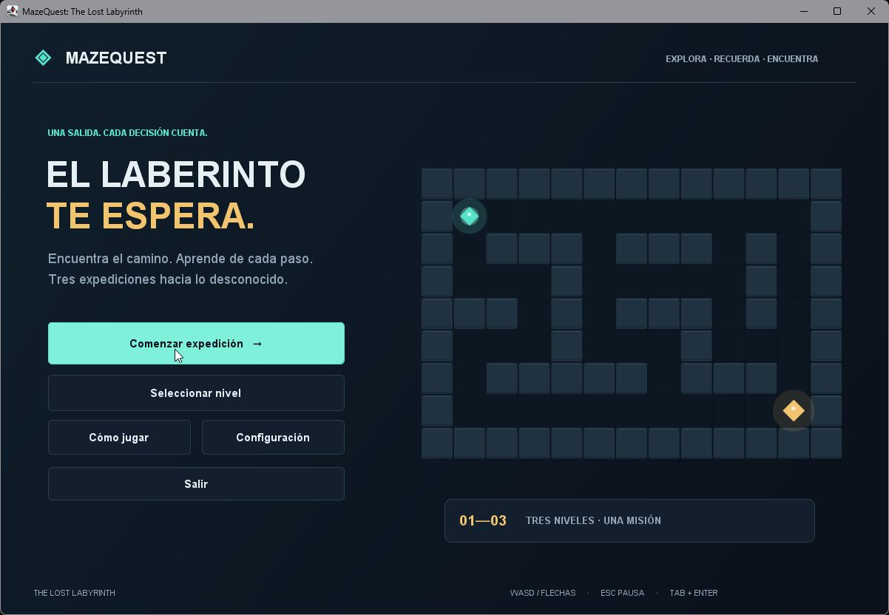
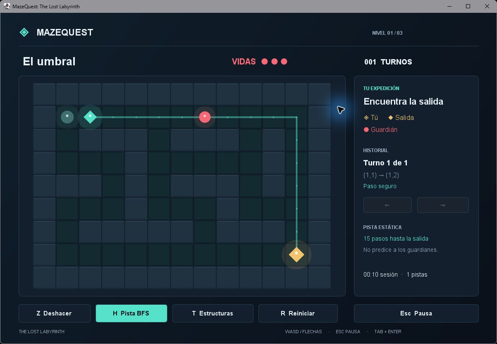
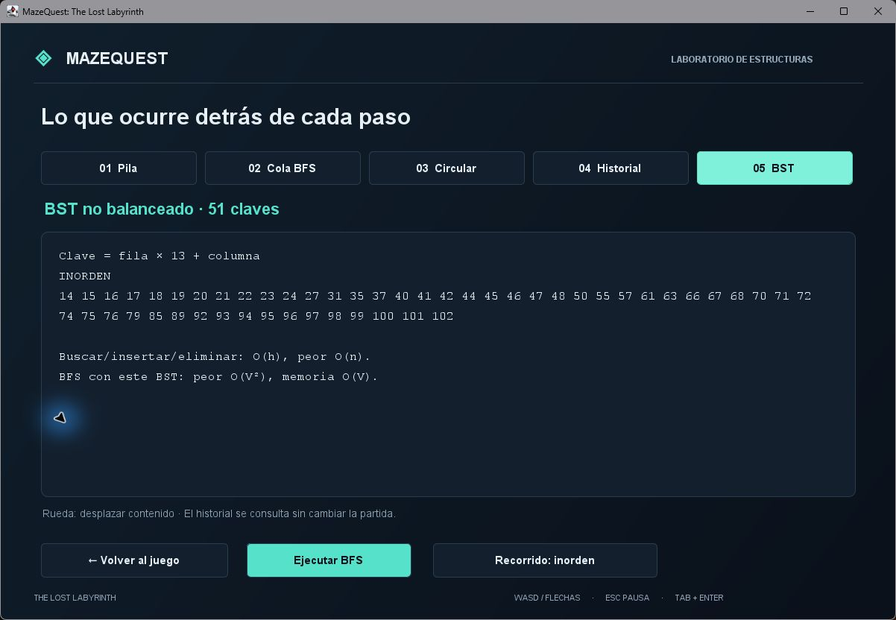

# Manual de usuario
MazeQuest · The Lost Labyrinth

Versión 1.0.0 · 15 de noviembre de 2026

Equipo: Juan David Paz Rodriguez y Andrea Fernanda Sapuyez.

## 1. Preparar y abrir el juego
Alcanza la salida dorada evitando guardianes. Cada nivel empieza con tres vidas. Puedes consultar pistas, revisar estructuras internas y deshacer decisiones.

Necesitas Java 21 y un escritorio gráfico. Si recibiste el JAR, abre una terminal en su carpeta:

```text
java -version
java -jar mazequest.jar
```

Si recibiste el proyecto fuente, instala también Maven y ejecuta desde la raíz:

```text
mvn -B -ntp clean verify javadoc:javadoc
java -jar target/mazequest.jar
```

La primera compilación descarga dependencias. Una partida no necesita Internet. El progreso no se guarda al cerrar.



«Comenzar expedición» abre El umbral. «Seleccionar nivel» permite elegir cualquiera de los tres mapas. «Cómo jugar» resume las reglas. «Configuración» permite cambiar animaciones y visualización de celdas exploradas por BFS.

<!-- pagebreak -->
## 2. Orientarse y moverse
El rombo turquesa es el jugador; el rombo dorado, la salida; los círculos rojos, los guardianes. La cabecera muestra vidas y turnos. A la derecha están el historial, el resultado de la pista y el reloj.



| Acción | Control |
|---|---|
| Mover una celda | Flechas o W, A, S, D |
| Deshacer turno | Z o botón Deshacer |
| Calcular pista BFS | H o botón Pista BFS |
| Abrir / cerrar estructuras | T |
| Reiniciar | R y confirmar |
| Pausar / volver / cancelar | Esc, según pantalla |
| Seleccionar y activar botón | Tab y Enter, o ratón |
| Consultar historial | Flechas del panel derecho |

No hay diagonales ni acción de esperar. Un muro no consume turno ni mueve enemigos. Durante la animación breve de un paso se bloquea otro movimiento; las animaciones pueden desactivarse desde el menú.

El reloj mide tiempo de sesión, incluida la pausa y la consulta de estructuras. Los enemigos avanzan por turnos, no por ese reloj.

<!-- pagebreak -->
## 3. Vidas, victoria y deshacer
Cada movimiento válido avanza una posición a todos los guardianes. Hay colisión al entrar en una celda ocupada por un guardián antes o después de su avance. Intercambiar posiciones también causa daño. Aunque coincidan varios enemigos, se pierde como máximo una vida por turno.

Después del daño reapareces en la entrada y las patrullas vuelven a sus posiciones iniciales. Entrada y salida quedan fuera de las patrullas. Llegar a la salida gana el nivel; perder las tres vidas termina en derrota. La pantalla final permite continuar al siguiente nivel cuando corresponde, volver a intentar o deshacer.

Z restaura posición, vidas, turno, victoria/derrota y fase de todos los guardianes. También retira el último registro del historial. El reloj y el contador de pistas no se rebobinan. Reiniciar vacía pila e historial y restablece vidas, patrullas, reloj y pistas.

| Nivel | Columnas × filas | Guardianes |
|---|---|---|
| El umbral | 13 × 9 | 1 |
| Las galerías | 17 × 11 | 2 |
| El santuario | 21 × 13 | 3 |

## 4. Pistas e historial
H calcula un camino mínimo entre tu celda y la salida. La línea turquesa señala la ruta; las celdas exploradas pueden ocultarse en Configuración. La pista considera muros y pasillos, pero no predice guardianes: seguirla no garantiza evitar daño.

Mover, deshacer, reiniciar o cambiar de nivel descarta la pista anterior. Mientras se calcula aparece «Explorando…». Espera a que termine antes de solicitar otra.

Las flechas del historial permiten consultar movimientos sin mover al jugador ni a los enemigos. El registro distingue destino intentado y posición final tras reaparecer. Consultar un registro no equivale a deshacer.

## 5. Pausa y salida
Esc abre la pausa; «Continuar» o Esc la cierran. Desde la pausa puedes volver al menú con confirmación. R pide confirmación antes de reiniciar. Cerrar la ventana también solicita confirmación. No se conserva un archivo de progreso.

<!-- pagebreak -->
## 6. Laboratorio de estructuras
T abre el laboratorio. Selecciona Pila, Cola BFS, Circular, Historial o BST. La rueda desplaza contenido largo. T, Esc o «Volver al juego» regresan a la partida.



Pila muestra estados para deshacer; Circular, rutas y cursores; Historial alterna las dos direcciones de recorrido. Cola y BST necesitan una búsqueda: «Ejecutar BFS» permite calcularla aquí.

La cola mostrada es una instantánea de su máxima ocupación, no la cola final ni una animación en vivo. BST muestra claves de celdas y permite alternar inorden, preorden y posorden. Los datos proceden de la partida y del cálculo reales.

## 7. Problemas habituales
| Síntoma | Qué revisar |
|---|---|
| «java» no se reconoce | Instalar JDK 21, agregar bin al PATH y abrir otra terminal. |
| Versión de clase incompatible | Usar Java 21 o posterior con el JAR compilado para 21. |
| No aparece ventana | Usar una sesión con escritorio gráfico. |
| Teclas sin respuesta | Dar foco a la ventana, cerrar el diálogo y esperar la animación. |
| La pista cruza un guardián | Es estática: observar la patrulla antes de avanzar. |
| Deshacer no disponible | No existe un turno válido previo o se acaba de reiniciar. |

La ejecución gráfica observada corresponde a Windows. CI también pasó en Ubuntu, pero no verifica su presentación gráfica. Las capturas reales del 14 y 15 de noviembre no documentan una partida manual completa.
